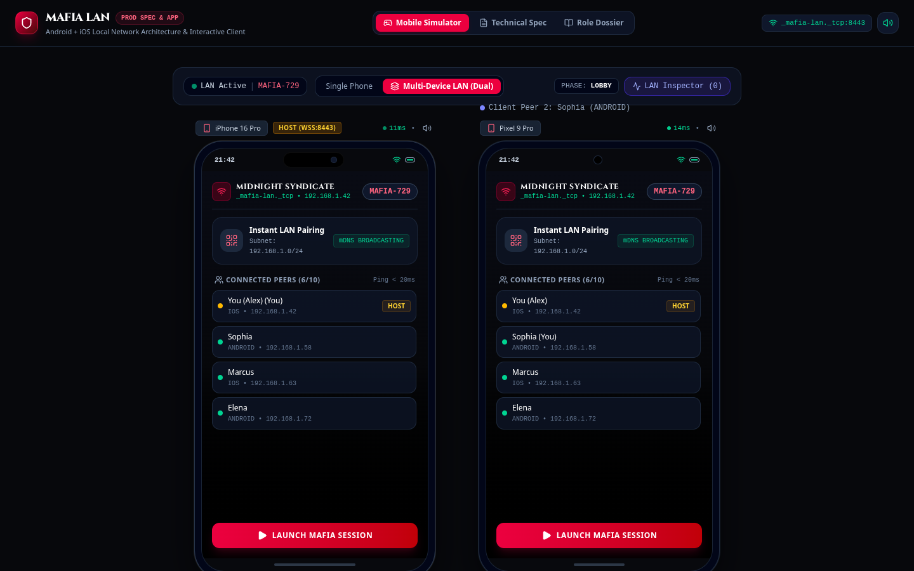
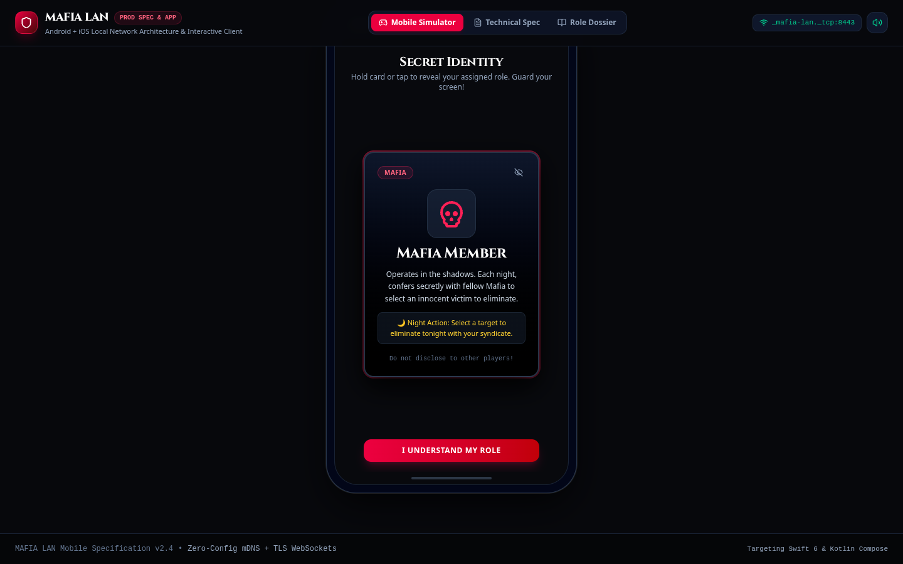
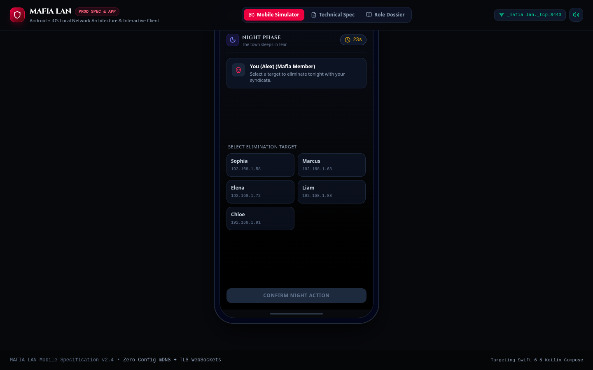
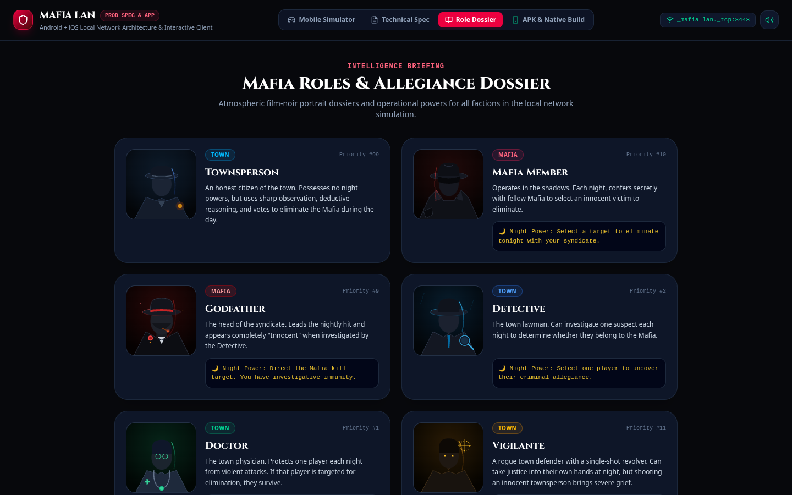
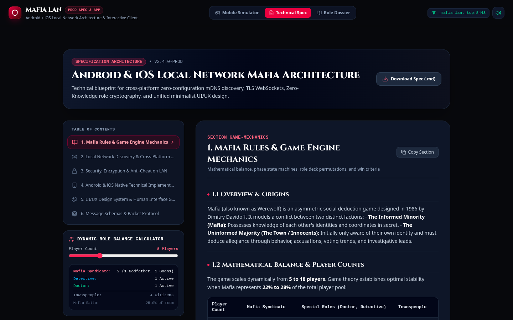
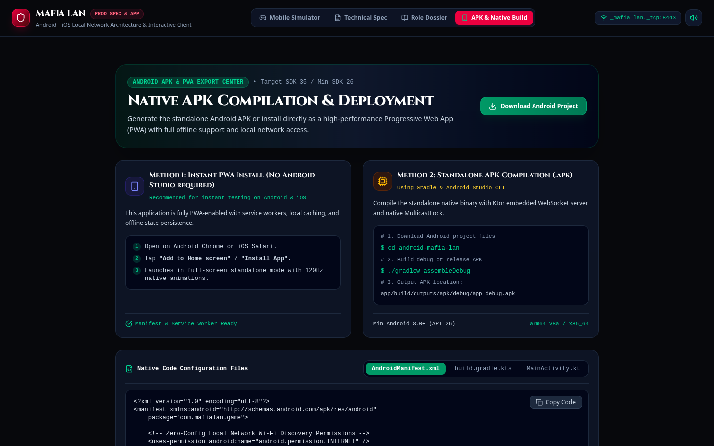
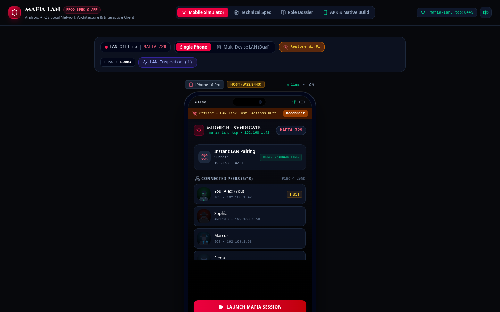

# Mafia LAN - Play Mafia with friends over Wifi/LAN

[](https://naqushab.github.io/Mafia-LAN/)
[](#build--installation-instructions)
[](#local-network-architecture)
[](#zero-knowledge-role-secrecy--anti-cheat)
[-success.svg)](#45-github-actions-cicd-autobuild-web-android-apk-ios)
[](#testing--quality-assurance)
[](#license)

> A production-grade mobile social deduction client and architectural specification for Android, iOS, and Web. Engineered for zero-configuration, encrypted peer-to-peer multiplayer sessions over local Wi-Fi router or peer hotspot networks without requiring cloud relays or internet access.
> **Android App Name:** `Mafia LAN: Local WiFi Party Game` | **Package:** `com.mafialan.game`

---

## Table of Contents
- [1. Overview & Key Capabilities](#1-overview--key-capabilities)
  - [1.1 Play Live in a Browser (No Native App Needed)](#11-play-live-in-a-browser-no-native-app-needed)
- [2. Screenshots & Visual Walkthrough](#2-screenshots--visual-walkthrough)
- [3. How to Play Mafia](#3-how-to-play-mafia)
  - [3.1 Factions & Win Criteria](#31-factions--win-criteria)
  - [3.2 Role Dossier & Action Matrix](#32-role-dossier--action-matrix)
  - [3.3 Mathematical Balance Table](#33-mathematical-balance-table)
  - [3.4 Night Action Turn Sequence](#34-night-action-turn-sequence)
  - [3.5 Day Discussion, Accusations & Gallows Trial](#35-day-discussion-accusations--gallows-trial)
- [4. Build & Installation Instructions](#4-build--installation-instructions)
  - [4.1 Web Client (React 19, TypeScript, Vite)](#41-web-client-react-19-typescript-vite)
  - [4.2 Android Native (Kotlin, Jetpack Compose, Gradle APK)](#42-android-native-kotlin-jetpack-compose-gradle-apk)
  - [4.3 iOS Native (Swift 6, SwiftUI, Network.framework)](#43-ios-native-swift-6-swiftui-networkframework)
  - [4.4 Instant PWA Standalone Mode](#44-instant-pwa-standalone-mode)
  - [4.5 GitHub Actions CI/CD Autobuild (Web, Android APK, iOS)](#45-github-actions-cicd-autobuild-web-android-apk-ios)
- [5. Local Network Architecture & Protocol](#5-local-network-architecture--protocol)
  - [5.0 Live PWA Transport (WebRTC, no server)](#50-live-pwa-transport-webrtc-no-server)
  - [5.1 Discovery: mDNS / Bonjour](#51-discovery-mdns--bonjour)
  - [5.2 Transport: TLS 1.3 WebSockets](#52-transport-tls-13-websockets)
  - [5.3 Wi-Fi Disconnection & State Reconciliation](#53-wi-fi-disconnection--state-reconciliation)
  - [5.4 Zero-Knowledge Role Secrecy & Anti-Cheat](#54-zero-knowledge-role-secrecy--anti-cheat)
- [6. Testing & Quality Assurance](#6-testing--quality-assurance)
- [7. Project Structure](#7-project-structure)
- [8. Contributing & Code of Conduct](#8-contributing--code-of-conduct)
- [9. License](#9-license)

---

## 1. Overview & Key Capabilities

- **Zero-Configuration LAN Discovery:** Uses standard mDNS / Bonjour (`_mafia-lan._tcp.local.`, port `8443`) to advertise and discover local games in `< 500ms` without typing IP addresses.
- **Real Browser-to-Browser Play (PWA):** The web build is a complete game, not a demo. One phone hosts, everyone else joins from the browser over a WebRTC DataChannel with a QR/link handshake — no native app, account, server or internet required on the same Wi-Fi.
- **Cross-Platform Compatibility:** Runs seamlessly across Android (Kotlin + Jetpack Compose), iOS (Swift 6 + SwiftUI), and Web / PWA.
- **Offline & Disconnection Resilience:** If a device temporarily loses Wi-Fi, actions are buffered in a local queue and reconciled automatically upon reconnection via sequence deltas (`reconcileStateOnReconnect`).
- **Haptic Vibration Engine & Tactile Feedback:** Configurable tactile vibration feedback with customized waveforms for role reveals (`[40, 60, 40ms]`), nightfall descent (`[80, 50, 100, 150ms]`), detective interrogations, and trial gavel verdicts. Includes a dedicated User Settings panel with intensity calibration (`soft`, `medium`, `heavy`), Web Vibration API (`navigator.vibrate`) integration, and realistic simulated frame rumble for desktop testing.
- **Zero-Knowledge Role Secrecy (ZkRS):** Protects players against Wi-Fi packet sniffing (Wireshark) and host memory dumping. Ephemeral `X25519` key exchange encrypts roles with the recipient's public key using `AES-256-GCM`.
- **Minimalist Scandinavian Noir Aesthetic:** Atmospheric high-contrast crime aesthetic with 120Hz ProMotion spring animations, 3D card flips, privacy shields, and a synthesized Web Audio sound engine.
- **Interactive Simulator:** Dual-mode emulator supporting single-device testing (iPhone 16 Pro / Pixel 9 Pro frames) and multi-device side-by-side local network simulation with live packet inspection.

### 1.1 Play Live in a Browser (No Native App Needed)

The deployed PWA at **https://naqushab.github.io/Mafia-LAN/** is a fully playable client. A guest only needs a browser and the same Wi-Fi network as the host:

1. **Host:** open the PWA, enter a name, tap **Play Live → Host a table**.
2. **Invite:** tap **Invite player** and show the QR code (or share the link) to the guest.
3. **Guest:** open the link or scan the QR on their phone. The invite is prefilled; enter a name and tap **Connect**.
4. **Handshake:** the guest shows a reply QR/link, which the host scans or pastes. The devices are now connected directly.
5. **Fill the table:** add AI bots if fewer than four humans are available, then tap **Deal roles & start**.
6. Play the full loop — secret role reveal, night actions, dawn report, discussion/accusations, nomination vote, gallows trial, verdict and game over.

How it works: the host device owns the authoritative `GameEngine`; signalling SDP is exchanged by QR/link (no signalling server) and gameplay runs over a WebRTC DataChannel. ICE uses host candidates only, so it stays on the local network and works with the internet switched off. Roles are filtered per recipient by the host before every broadcast; guests never receive another player's secret role.

> **Compatibility:** use a recent Chrome, Safari, Edge or Firefox build over `https://` or `localhost`. WebRTC and camera scanning require a secure context. If the camera is unavailable, every step has a copy/paste fallback.

---

## 2. Screenshots & Visual Walkthrough

### Multi-Device Local LAN Simulator (Host + Client Peer)
Simulate two phones simultaneously communicating over the virtual local network with real-time state synchronization, ping indicators, and hardware frames.


### 3D Secret Role Card Reveal & Anti-Peeking Shield
Touch-and-hold 3D perspective flip card with privacy borders and audio-tactile feedback to prevent screen peeking.


### Night Phase Tactical Targeting
Role-specific night operations (Mafia assassination, Detective interrogation, Doctor protection) with real-time countdown.


### Atmospheric Role Dossier Portraits
High-fidelity film-noir portrait artwork for all town, syndicate, and neutral operatives with night priority rankings.


### Technical Specification Document & Protocol Inspector
Complete cross-platform engineering blueprint, dynamic role balance calculator, and raw packet wire inspector.


### Android APK & Native Build Center
Ready-to-compile Gradle scripts, `AndroidManifest.xml`, Kotlin MainActivity, and PWA standalone installation instructions.


### Wi-Fi Disconnection & Graceful State Recovery
Simulate network dropouts. Actions buffer locally and automatically reconcile upon reconnect without losing assigned roles or living status.


---

## 3. How to Play Mafia

Mafia models a high-stakes psychological struggle between an **Informed Minority** (Mafia) and an **Uninformed Majority** (Townspeople).

### 3.1 Factions & Win Criteria

| Faction | Team Objective | Win Condition |
|---|---|---|
| **The Town** | Deduce and eliminate all criminals through daytime trial votes | All Mafia syndicate members are eliminated (`Mafia == 0`). |
| **The Mafia** | Deceive the town and assassinate citizens under cover of night | Living Mafia members equal or outnumber living Townspeople (`Mafia >= Town`). |
| **Neutral (Jester)** | Act suspicious and provoke the town into hanging you on the gallows | Convicted and executed by majority vote on the gallows during the Day. |

---

### 3.2 Role Dossier & Action Matrix

1. **Townsperson (Villager)**
   - *Faction:* Town • *Night Priority:* None
   - An honest citizen. Possesses no special night action, but relies on keen observation, deduction, and consensus voting during the day.
2. **Mafia Member**
   - *Faction:* Mafia • *Night Priority:* #10
   - Confers silently with fellow syndicate members each night to select one citizen for elimination.
3. **Godfather**
   - *Faction:* Mafia • *Night Priority:* #9
   - Syndicate crime boss. Has final say over the nightly target and possesses **Investigative Immunity** (appears completely *Innocent* to the Detective).
4. **Detective (Sheriff)**
   - *Faction:* Town • *Night Priority:* #2
   - Investigates one suspect each night. The system reveals whether the suspect is *Guilty (Mafia)* or *Innocent (Town / Godfather)*.
5. **Doctor (Medic)**
   - *Faction:* Town • *Night Priority:* #1
   - Selects one player each night to administer medical protection. If that player is attacked by the Mafia or Vigilante, the attack is absorbed and they survive.
6. **Vigilante**
   - *Faction:* Town • *Night Priority:* #11
   - A rogue sharpshooter with a single-shot revolver. Can eliminate a suspect at night, but shooting an innocent townsperson brings severe grief.
7. **Jester**
   - *Faction:* Neutral • *Night Priority:* None
   - A deceptive trickster who wins solely by getting voted onto the gallows and executed by town vote.

---

### 3.3 Mathematical Balance Table

The game balances dynamically from **5 to 18 players**. Game theory establishes optimal stability when the Mafia syndicate comprises **22% to 28%** of the room:

| Players | Mafia Syndicate | Special Roles (Doctor, Detective) | Townspeople | Mafia Ratio |
|---|---|---|---|---|
| **5 - 6** | 1 Mafia | 1 Detective, 1 Doctor | 2 - 3 Villagers | ~20.0% |
| **7 - 8** | 2 Mafia (1 Godfather, 1 Goon) | 1 Detective, 1 Doctor | 3 - 4 Villagers | ~25.0% |
| **9 - 11** | 3 Mafia (1 Godfather, 2 Goons) | 1 Detective, 1 Doctor, 1 Vigilante | 4 - 6 Villagers | ~27.3% |
| **12 - 15** | 3 - 4 Mafia | 1 Detective, 1 Doctor, 1 Vigilante, 1 Jester | 5 - 8 Villagers | ~25.0% |

---

### 3.4 Night Action Turn Sequence

To prevent race conditions on local networks, night resolutions execute in strict mathematical priority:
1. **Priority 1 — Doctor Protection:** Doctor applies `SHIELD_ACTIVE` to their chosen target.
2. **Priority 2 — Detective Inquiry:** Detective receives private confirmation of suspect alignment (`Innocent` vs `Guilty`).
3. **Priority 3 — Mafia Syndicate Kill:** Target is eliminated unless protected by `SHIELD_ACTIVE`. If shielded, a dawn announcement records `SAVED_BY_DOCTOR`.
4. **Priority 4 — Vigilante Shot:** Target is eliminated unless shielded.

---

### 3.5 Day Discussion, Accusations & Gallows Trial

1. **Morning Gazette Bulletin:** The town awakens. Casualties and miraculous doctor saves are publicly announced.
2. **Synchronized Discussion Timer (60s - 180s):** Players debate evidence, cross-examine alibis, and challenge conflicting claims.
3. **Suspect Nomination:** Any living player can be nominated for trial. A majority nomination threshold summons the accused to the stand.
4. **Defense Speech (20s):** The accused stands before the town to deliver their defense.
5. **Gallows Ballot:**
   - Living citizens vote: **Guilty (Hang)**, **Pardon (Innocent)**, or **Abstain**.
   - **Majority Rule:** If `Guilty > Pardon`, the suspect is condemned and their role is revealed.
   - **Tie Handling:** If `Guilty == Pardon`, the accused is **Pardoned** (defense prevails on tie).

---

## 4. Build & Installation Instructions

Build instructions are provided for all three target platforms: **Web**, **Android**, and **iOS**.

---

### 4.1 Web Client (React 19, TypeScript, Vite)

#### Prerequisites
- Node.js `20.x` or higher
- npm `10.x` or bun `1.1+`

#### 1. Clone & Install Dependencies
```bash
git clone https://github.com/your-username/mafia-lan.git
cd mafia-lan
npm install
```

#### 2. Start Local Development Server
```bash
npm run dev
```
The application will launch on `http://localhost:3000`.

#### 3. Run Automated Logic Tests
```bash
npm test
```

#### 4. Build Production Static Assets
```bash
npm run build
```
Production assets are generated in the `dist/` directory, ready to serve via Nginx, Caddy, or static hosting.

---

### 4.2 Android Native (Kotlin, Jetpack Compose, Gradle APK)

- **Application Label / Name:** `Mafia LAN: Local WiFi Party Game`
- **Application ID:** `com.mafialan.game`

#### Prerequisites
- **Android Studio** (Ladybug 2024.2+ or Koala)
- **Android SDK:** Compile SDK 35, Min SDK 26 (Android 8.0 Oreo+)
- **JDK:** OpenJDK 17 or 21
- Physical Android phone or emulator connected to local Wi-Fi

#### 1. AndroidManifest Permissions (`app/src/main/AndroidManifest.xml`)
Ensure the following permissions are present to allow mDNS discovery and prevent Wi-Fi sleep:
```xml
<uses-permission android:name="android.permission.INTERNET" />
<uses-permission android:name="android.permission.ACCESS_NETWORK_STATE" />
<uses-permission android:name="android.permission.ACCESS_WIFI_STATE" />
<uses-permission android:name="android.permission.CHANGE_WIFI_MULTICAST_STATE" />
<uses-permission android:name="android.permission.VIBRATE" />
```

#### 2. Wi-Fi MulticastLock in Kotlin (`MainActivity.kt`)
On Android, devices automatically filter multicast mDNS packets to save battery unless a `MulticastLock` is held:
```kotlin
package com.mafialan.game

import android.net.wifi.WifiManager
import android.os.Bundle
import androidx.activity.ComponentActivity

class MainActivity : ComponentActivity() {
    private var multicastLock: WifiManager.MulticastLock? = null

    override fun onCreate(savedInstanceState: Bundle?) {
        super.onCreate(savedInstanceState)
        val wifiManager = applicationContext.getSystemService(WIFI_SERVICE) as WifiManager
        multicastLock = wifiManager.createMulticastLock("MafiaLanMulticastLock").apply {
            setReferenceCounted(true)
            acquire()
        }
    }

    override fun onDestroy() {
        super.onDestroy()
        multicastLock?.release()
    }
}
```

#### 3. Compile Standalone APK via Gradle CLI
```bash
# Navigate to the Android project directory
cd android

# Build Debug APK
./gradlew assembleDebug

# Output APK path:
# app/build/outputs/apk/debug/app-debug.apk
```

#### 4. Install APK directly onto Connected Android Device
```bash
adb install -r app/build/outputs/apk/debug/app-debug.apk
```

#### 5. Build Signed Release APK or Android App Bundle (AAB)
```bash
./gradlew assembleRelease
# or for Google Play:
./gradlew bundleRelease
```

---

### 4.3 iOS Native (Swift 6, SwiftUI, Network.framework)

#### Prerequisites
- macOS Sonoma (14.5+) or Sequoia (15.0+)
- **Xcode 16.0+**
- iOS 17.0+ deployment target
- Apple Developer Account (for device provisioning)

#### 1. `Info.plist` Local Network Keys
iOS enforces strict local network sandbox permissions. Add the following keys to your target's `Info.plist`:
```xml
<key>NSLocalNetworkUsageDescription</key>
<string>Mafia LAN requires local network access to discover and host nearby game rooms over Wi-Fi.</string>
<key>NSBonjourServices</key>
<array>
    <string>_mafia-lan._tcp</string>
</array>
```

#### 2. Zero-Config Bonjour Discovery in Swift (`LocalRoomBrowser.swift`)
```swift
import Network
import Combine

final class LocalRoomBrowser: ObservableObject {
    @Published var discoveredRooms: [NWBrowser.Result] = []
    private var browser: NWBrowser?

    func startBrowsing() {
        let descriptor = NWBrowser.Descriptor.bonjour(type: "_mafia-lan._tcp", domain: "local.")
        let parameters = NWParameters()
        parameters.includePeerToPeer = true // Supports Wi-Fi Direct and peer hotspots
        
        browser = NWBrowser(for: descriptor, using: parameters)
        browser?.browseResultsChangedHandler = { [weak self] results, _ in
            DispatchQueue.main.async {
                self?.discoveredRooms = Array(results)
            }
        }
        browser?.start(queue: .main)
    }

    func stopBrowsing() {
        browser?.cancel()
        browser = nil
    }
}
```

#### 3. Build & Archive via Xcode CLI (`xcodebuild`)
```bash
# Build for connected iOS device
xcodebuild -workspace MafiaLAN.xcworkspace \
           -scheme MafiaLAN \
           -configuration Release \
           -destination 'generic/platform=iOS' \
           -archivePath build/MafiaLAN.xcarchive \
           archive

# Export to IPA for Ad-Hoc / Enterprise distribution
xcodebuild -exportArchive \
           -archivePath build/MafiaLAN.xcarchive \
           -exportPath build/output \
           -exportOptionsPlist exportOptions.plist
```

---

### 4.4 Instant PWA Standalone Mode

**Live deployment:** **https://naqushab.github.io/Mafia-LAN/**

Every push to `main`/`master` builds the web client and publishes it to GitHub Pages via the `deploy-web` job in `.github/workflows/ci-cd.yml` (GitHub Actions artifact → `actions/deploy-pages`). No manual deploy step, no separate host.

For instant local play on any Android or iOS phone without installing Android Studio or Xcode:
1. Open **https://naqushab.github.io/Mafia-LAN/** on your phone's browser (**Google Chrome** on Android or **Safari** on iOS).
2. Tap the browser share/menu icon and select **"Add to Home Screen"** or **"Install App"**.
3. The app installs as a standalone, borderless application supporting 120Hz smooth display and offline local storage caching.

PWA assets live in `public/`: `manifest.webmanifest` (name, icons, standalone display), `sw.js` (offline shell + runtime cache, network-first for navigations so a new deploy lands immediately), and the generated icon set from `scripts/generate-icons.py` (`public/icon-192.png`, `icon-512.png`, `apple-touch-icon.png`). Asset URLs are rewritten to the `/Mafia-LAN/` base at build time via `VITE_BASE_PATH`, which the workflow sets from the repository name — so a fork deploys correctly under its own sub-path with no edits.

---

### 4.5 GitHub Actions CI/CD Autobuild (Web, Android APK, iOS)

Mafia LAN includes an automated multiplatform CI/CD pipeline configured at `.github/workflows/ci-cd.yml`. Every git commit (`push`) or `pull_request` targeted to `main` or `master` initiates parallel matrix builds:

```
[git commit / push]
       │
       ├──► Job 1: Web App (Ubuntu + Node 20)
       │    ├── Run 36 deterministic rules, live engine & signaling tests
       │    ├── Type-check via tsc --noEmit
       │    └── Compile Vite production bundle -> dist/ artifact
       │
       ├──► Job 2: Android APK (Ubuntu + Temurin JDK 17)
       │    ├── Run ./gradlew assembleDebug
       │    ├── Compute SHA-256 APK binary checksums
       │    └── Upload standalone app-debug.apk artifact
       │
       ├──► Job 3: iOS Native (macOS 15 Apple Silicon + Xcode 16)
       │    ├── Verify Bonjour NSLocalNetworkUsageDescription Info.plist
       │    ├── Compile simulator & ad-hoc binary via xcodebuild
       │    └── Package & upload MafiaLAN-iOS-Simulator.zip artifact
       │
       ├──► Job 4: GitHub Release (Ubuntu)
       │    ├── Download the Android APK(s) + iOS simulator zip
       │    ├── Generate SHA-256SUMS.txt and release notes
       │    └── Publish/update the rolling `continuous` release (tags -> versioned release)
       │
       └──► Job 5: CI/CD Multiplatform Summary
            └── Formats GitHub Step Summary with download links & test metrics
```

#### 1. Workflow Triggers
- Automatic on **Push** to `main` and `master`.
- Automatic on **Pull Request** to `main` and `master`.
- Manual on-demand via **Workflow Dispatch** ("Run workflow" button in the GitHub Actions UI).

#### 2. Downloading Generated Artifacts
1. Go to the **Actions** tab on your GitHub repository.
2. Select the latest workflow run: **"Mafia LAN - CI/CD Multiplatform Build"**.
3. Scroll to the **Artifacts** section at the bottom:
   - `mafia-lan-web-production`: Static web build ready for deployment.
   - `mafia-lan-android-debug-apk`: Standalone installable Android `.apk` for phones and emulators.
   - `mafia-lan-ios-simulator-app`: Zipped `.app` bundle for testing in the Xcode iOS Simulator or ad-hoc test devices.

The same APK(s) and iOS zip are attached automatically to the [**Releases**](https://github.com/naqushab/Mafia-LAN/releases) page (`continuous` rolling prerelease for every push to `main`, or a versioned release when a `v*` tag is pushed), together with `SHA256SUMS.txt`. You no longer need a GitHub account to download a build.

#### 3. Optional Secrets for Production App Signing
To enable self-signed production Android APKs and TestFlight distribution, add these repository secrets in **Settings → Secrets and variables → Actions**:
- `ANDROID_KEYSTORE_BASE64`: Base64 encoded release `.keystore` / `.jks` file.
- `KEYSTORE_PASSWORD`: Keystore decryption password.
- `KEY_ALIAS`: Signing key alias.
- `KEY_PASSWORD`: Key private passphrase.

---

## 5. Local Network Architecture & Protocol

### 5.0 Live PWA Transport (WebRTC, no server)

The browser client is a real peer-to-peer implementation, independent of the native mDNS/TLS blueprint:

- **Topology:** star — the host device runs one authoritative `GameEngine`, each guest holds a single `RTCDataChannel` to it.
- **Signalling:** SDP offer/answer tokens are exchanged out-of-band as QR codes, share links (`#join=`, `#answer=`) or copy/paste. There is no signalling server.
- **ICE:** host candidates only (`iceServers: []`), so connections stay on the local subnet and work with no internet. Same Wi-Fi is required.
- **Authority & secrecy:** every action is validated by the host engine. `PublicState` is broadcast to everyone; `PrivateState` (role, faction, teammates, detective report) is filtered and sent per recipient.
- **Match loop:** `lobby → role_reveal → night → dawn → day → voting → trial → verdict → night…`, ending in `game_over`. All transitions are covered by `src/live/engine.test.ts`.

### 5.1 Discovery: mDNS / Bonjour
- **Service Name:** `_mafia-lan._tcp.local.`
- **Default Port:** `8443` (TLS WebSocket) / `8080` (Plaintext dev)
- **TXT Records:**
  - `code=MAFIA-729` (Room PIN)
  - `name="Midnight Lounge"` (Human-readable room title)
  - `slots="6/10"` (Player occupancy)
  - `proto=2` (Protocol version)

### 5.2 Transport: TLS 1.3 WebSockets
Once discovered, client phones establish a direct WebSocket connection to the host device's local subnet IP (`192.168.1.X:8443`). Heartbeat ping/pongs run every `2,000ms`.

### 5.3 Wi-Fi Disconnection & State Reconciliation
When a player's phone disconnects from Wi-Fi (e.g. walking out of range or receiving an incoming call):
1. The client enters `RECONNECTING` mode with a **45-second grace countdown**.
2. Any player actions (votes, night attacks, chat messages) are buffered in a local FIFO queue.
3. Upon reconnecting, the client issues a `RECONNECT_SYNC` packet containing its last acknowledged sequence number (`lastSeq`).
4. The host evaluates `reconcileStateOnReconnect()`, preserves the player's alive status, replays buffered actions, and responds with the current room state delta.

### 5.4 Zero-Knowledge Role Secrecy & Anti-Cheat
Standard LAN games are vulnerable to packet sniffers (Wireshark) on open Wi-Fi:
1. During lobby setup, every peer generates an ephemeral `X25519` key pair.
2. The host encrypts each player's secret role with the recipient's public key using `AES-256-GCM`.
3. The host computes a SHA-256 commitment of the complete role shuffle (`Hash(Deck + Nonce)`) to guarantee the host did not alter roles midway.
4. Neither other players on the Wi-Fi nor host memory inspection can uncover who holds which role until the game concludes.

---

## 6. Testing & Quality Assurance

The codebase decouples pure game rules from UI rendering, enabling high-speed unit testing alongside end-to-end browser automation:

### Running Unit Tests
```bash
npm test
```

#### Test Suite Matrix (36/36 Passing)
- **Rules engine (13):** role assignment and faction alignment, night kills, Doctor protection, Detective/Godfather immunity, multi-attacker Doctor shielding, mafia/town/jester win conditions, nomination majority, gallows tie → pardon, Wi-Fi reconnect reconciliation, 4–16 player scaling, and the classic role randomizer.
- **Live P2P engine (19):** lobby gates, role reveal → night, shared syndicate hit with Godfather override, private investigations, nomination → trial → verdict → nightfall, pardons, jester victory, hidden-role projection, timer-driven phases, verdict visibility, and a complete game played from role reveal to winner, plus restart.
- **Signaling codecs (4):** offer/answer round-trips, `#join=`/`#answer=` share-link parsing, and rejection of malformed invite codes.

---

## 7. Project Structure

```
├── MAFIA_SPECIFICATION.md       # Comprehensive system architecture & protocol spec
├── README.md                    # Project documentation & build instructions
├── AGENTS.md                    # Architecture & state machine guidelines for AI agents
├── index.html                   # HTML entry point with metadata & web fonts
├── package.json                 # Node dependencies (React 19, Motion, Lucide)
├── docs/
│   └── screenshots/             # Visual walkthrough captures
├── src/
│   ├── App.tsx                  # Primary layout and top tab navigation
│   ├── main.tsx                 # React application root
│   ├── index.css                # Tailwind CSS v4 styling & 3D card utilities
│   ├── components/
│   │   ├── DeviceFrame.tsx      # iPhone 16 Pro & Pixel 9 Pro device frames
│   │   ├── GameSimulator.tsx    # Interactive single & dual phone LAN simulator
│   │   ├── LiveGame.tsx         # Real P2P lobby, QR handshake & live game view
│   │   ├── live/
│   │   │   ├── NominationView.tsx # Phone-first nomination vote screen
│   │   │   └── QrTools.tsx      # Local QR render/scan + clipboard/share helpers
│   │   ├── RoleCard.tsx         # 3D interactive flip card with privacy guard
│   │   ├── RolePortraits.tsx    # Film-noir vector SVG portraits for all roles
│   │   ├── NightPhaseView.tsx   # Night action selection and timer
│   │   ├── DawnReportView.tsx   # Morning incident newspaper bulletin
│   │   ├── DayDiscussionView.tsx# Town debate, accusations, and chat
│   │   ├── TrialVotingView.tsx  # Suspect defense stand & live vote tally
│   │   ├── GameOverView.tsx     # Victory debrief and complete identity disclosure
│   │   ├── ApkBuildCenter.tsx   # Android APK & PWA installation center
│   │   ├── SpecificationView.tsx# Technical specification browser & calculators
│   │   └── NetworkInspectorModal.tsx # Live mDNS and WebSocket packet logger
│   ├── game/
│   │   ├── rules.ts             # Decoupled pure Mafia game rules & reconciliation
│   │   └── rules.test.ts        # Automated unit tests (node:test)
│   ├── live/
│   │   ├── engine.ts            # Authoritative host engine for live P2P games
│   │   ├── engine.test.ts       # Live state-machine tests (node:test)
│   │   ├── protocol.ts          # Wire messages, timings & SDP signal tokens
│   │   ├── protocol.test.ts     # Invite/answer codec tests
│   │   ├── session.ts           # Host/guest session layer over the engine
│   │   ├── transport.ts         # Serverless WebRTC DataChannel handshake
│   │   └── viewModel.ts         # Per-viewer public/private projection helpers
│   ├── services/
│   │   ├── soundEffects.ts      # Web Audio synthesized sound engine
│   │   └── persistence.ts       # LocalStorage session state persistence
│   ├── spec/
│   │   └── mafiaSpecData.ts     # Complete technical specification content
│   └── types/
│       └── mafia.ts             # TypeScript definitions for roles, packets, phases
```

---

## 8. Contributing & Code of Conduct

1. Ensure all game logic modifications reside in `src/game/rules.ts` (shared rules) or `src/live/engine.ts` (live state machine) rather than UI components.
2. Accompany any new rule mechanics or edge cases with corresponding unit tests in `src/game/rules.test.ts`, `src/live/engine.test.ts` or `src/live/protocol.test.ts`.
3. Verify clean compilation with `npm run build` and run `npm test` before submitting pull requests.

---

## 9. License

This project is licensed under the **Apache License 2.0**. See the [LICENSE](LICENSE) file for details.
